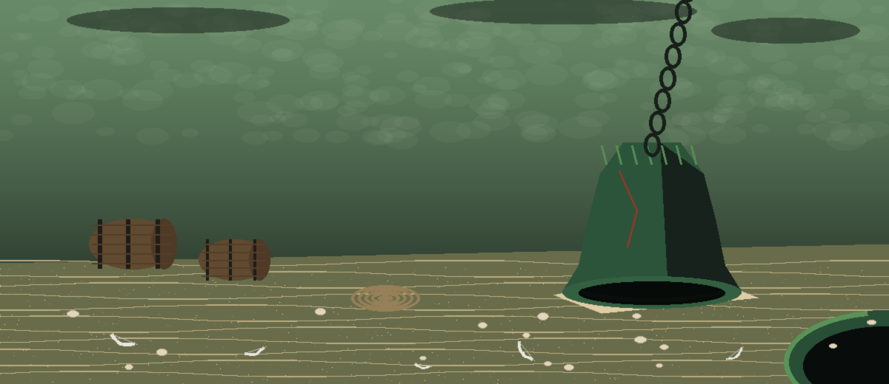
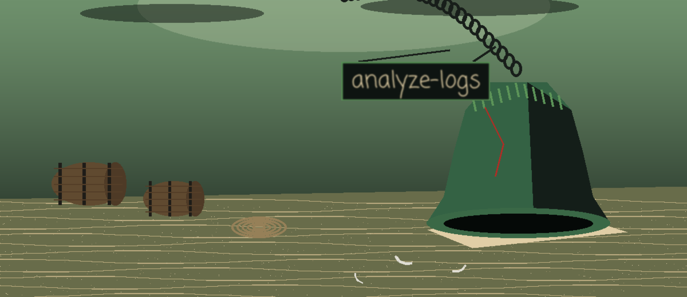

# analyze-logs

Parse and analyze log files for patterns, focusing on automated data analysis and reporting

## Install
`git clone https://github.com/ShadowStrikeHQ/analyze-logs`

## Usage
`./analyze-logs [params]`

## Parameters
- `-h`: Show help message and exit
- `-p`: Regex pattern to search for in the log file.
- `-o`: No description provided
- `-l`: No description provided
- `--ip_address`: Extract and analyze IP addresses.
- `--error_codes`: Extract and analyze error codes.
- `--user_agents`: Extract and analyze User-Agent strings.

## License
Copyright (c) ShadowStrikeHQ

> Slate note: -o and -l arrive with no description provided in the source, and the usage line names no log file to parse. Both gaps are left as gaps here, with nothing invented to fill them.
